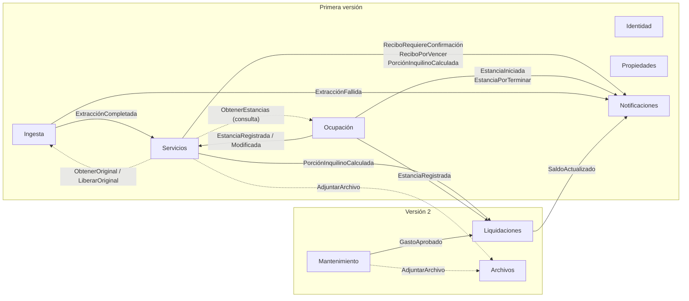
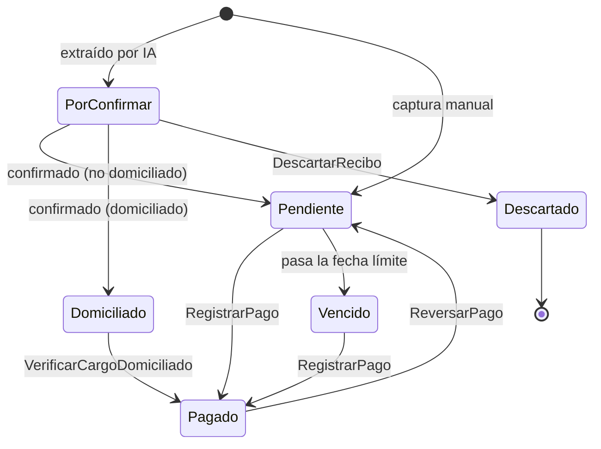
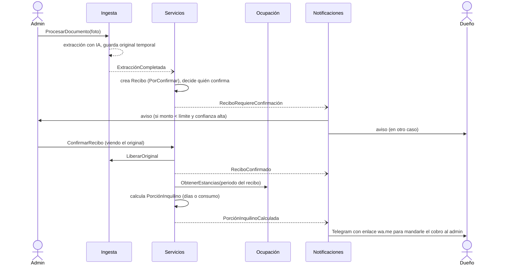

# Mapa de módulos — Administrador de Rentas

> **Versión:** 0.3.1 (borrador) · **Fecha:** 2026-11-23 · **Estado:** En revisión
>
> Este documento describe los módulos del monolito, qué datos tiene cada uno, qué expone y cómo se comunican. Debe cumplir el **Principio II** de la [constitución](../constitution.md).

---

## Convenciones

- **Comandos:** acciones que cambian estado, expuestas en la API pública del módulo. Se nombran en infinitivo (`RegistrarRecibo`).
- **Consultas:** lecturas síncronas expuestas en la API pública. Se nombran con `Obtener…` o `Listar…`.
- **Eventos de integración:** hechos ya ocurridos que un módulo publica en el bus interno. Se nombran en participio (`ReciboConfirmado`).
  - Llevan **identificadores y los datos mínimos** que necesitan los consumidores, no entidades completas.
  - Viven en el proyecto o paquete de **contratos** del módulo que los publica (`<Módulo>.Contratos`).
  - Los consumidores deben ser **idempotentes**: recibir un evento dos veces no duplica nada.
- **Datos:** cada módulo es dueño de un esquema en PostgreSQL con el mismo nombre (`servicios`, `ocupacion`, …).

---

## Vista general

- **Línea continua:** evento de integración (asíncrono, en el proceso).
- **Línea punteada:** consulta o comando a la API pública (síncrono).
- `Identidad` y `Propiedades` no aparecen con flechas porque **todos** los módulos los consultan para validar acceso y obtener datos de la propiedad, como la zona horaria.

---

## Módulos de la primera versión

### 1. Identidad

**Responsabilidad:** usuarios, autenticación, roles y qué propiedades puede ver cada usuario.

| | |
|---|---|
| **Datos** | `Usuario` (nombre, correo, rol: `dueño` / `administrador`, chat de Telegram), `AsignaciónPropiedad` (usuario ↔ propiedad) |
| **Comandos** | `InvitarAdministrador`, `AsignarPropiedad`, `VincularTelegram` |
| **Consultas** | `ObtenerUsuarioActual`, `PuedeAcceder(usuario, propiedad)`, `ListarUsuariosDePropiedad(propiedad, rol?)` |
| **Publica** | `AdministradorAsignado` |
| **Consume** | — |

### 2. Propiedades

**Responsabilidad:** datos generales de cada propiedad y su configuración.

| | |
|---|---|
| **Datos** | `Propiedad` (nombre, dirección, zona horaria, moneda), `Configuración` (límite de confirmación del admin, valor inicial $1,500 MXN) |
| **Comandos** | `RegistrarPropiedad`, `ActualizarConfiguración` |
| **Consultas** | `ObtenerPropiedad`, `ObtenerConfiguración`, `ListarPropiedades(usuario)` |
| **Publica** | `ConfiguraciónActualizada` |
| **Consume** | — |

### 3. Ingesta

**Responsabilidad:** recibir documentos (foto, PDF o correo), extraer sus datos con IA y conservar el original **solo mientras se confirma** (constitución, Principios IV.2 y IV.3).

| | |
|---|---|
| **Datos** | `Extracción` (metadatos del documento: nombre, tipo, tamaño, origen `correo` / `subida` / `foto`, huella SHA-256, quién lo envió; proveedor y modelo de IA, campos extraídos, confianza, advertencias), `OriginalTemporal` (extracción, contenido, expira en) |
| **Comandos** | `ProcesarDocumento` (recibe el archivo, extrae y guarda el original temporal), `LiberarOriginal(extracción)` (borra el original), `ReintentarExtracción` (solo mientras exista el original) |
| **Consultas** | `ObtenerExtracción`, `ObtenerOriginal(extracción)` (si sigue disponible), `ExisteHuella(huella)` |
| **Publica** | `ExtracciónCompletada`, `ExtracciónFallida`, `DocumentoDuplicado`, `OriginalExpirado` |
| **Consume** | — |
| **Puertos** | `IExtractorDocumentos` (proveedor de IA), `IBuzónCorreo` (recibos reenviados por correo) |
| **Trabajos programados** | Diario: borra originales con más de 7 días → `OriginalExpirado` |

- `ExtracciónCompletada` lleva campos **genéricos de recibo** (proveedor, número de servicio, periodo, consumo, monto, fecha límite, confianza). `Ingesta` **no conoce** el concepto de `Recibo` de `Servicios`: solo extrae; la interpretación es de `Servicios`.
- Si la huella ya existe, no se llama a la IA y se publica `DocumentoDuplicado`. Esto también evita pagar dos veces por la misma extracción.
- El original se borra cuando `Servicios` llama a `LiberarOriginal` (al confirmar o descartar el recibo) o cuando vence a los 7 días.
- `Ingesta` **no escucha eventos de `Servicios`**: es `Servicios` quien le avisa con un comando. Así la dependencia va en un solo sentido (`Servicios` → `Ingesta`) y no hay ciclo.

### 4. Servicios

**Responsabilidad:** servicios de la propiedad, sus recibos, pagos, medidores y el prorrateo hacia el inquilino.

| | |
|---|---|
| **Datos** | `Servicio` (proveedor, número de contrato, periodicidad, domiciliado, tiene medidor), `Recibo` (periodo, monto, consumo, fecha límite, estado, extracción de origen), `Pago` (inmutable: monto, fecha, referencia de comprobante, reverso de), `Lectura` (medidor, fecha, valor, quién la tomó), `PorciónInquilino` (recibo, estancia, método, monto) |
| **Comandos** | `RegistrarServicio`, `RegistrarRecibo` (manual), `ConfirmarRecibo`, `DescartarRecibo`, `RegistrarPago`, `ReversarPago`, `VerificarCargoDomiciliado`, `RegistrarLectura` |
| **Consultas** | `ListarRecibos(propiedad, estado?, periodo?)`, `ObtenerResumenServicios(propiedad)`, `ObtenerHistorialConsumo(servicio)` |
| **Publica** | `ReciboRegistrado`, `ReciboRequiereConfirmación`, `ReciboConfirmado`, `ReciboDescartado`, `ReciboPorVencer`, `ReciboVencido`, `ReciboPagado`, `PagoReversado`, `PorciónInquilinoCalculada`, `ConsumoAlto` |
| **Consume** | `ExtracciónCompletada` (crea el recibo *por confirmar*), `EstanciaRegistrada` / `EstanciaModificada` (recalcula prorrateos) |
| **Trabajos programados** | Diario: revisar vencimientos → `ReciboPorVencer` / `ReciboVencido` |

**Estados del recibo:**

**Quién confirma** (constitución, Principio IV): si el monto es menor al límite y la IA no reporta baja confianza, puede confirmar el admin; en cualquier otro caso, el dueño. `Servicios` obtiene el límite de `Propiedades`.

Al confirmar, la pantalla muestra los datos extraídos junto al original, que `Servicios` obtiene con `ObtenerOriginal`. Al confirmar o descartar, `Servicios` llama a `LiberarOriginal`.

### 5. Ocupación

**Responsabilidad:** inquilinos y estancias (vacacionales y mensuales).

| | |
|---|---|
| **Datos** | `Inquilino` (alias, contacto), `Estancia` (tipo: `vacacional` / `mensual`, periodo `[inicio, fin)`, precio, inquilino cubre servicios, método de prorrateo: `días` / `consumo`) |
| **Comandos** | `RegistrarEstancia`, `ModificarEstancia`, `IniciarEstancia` (check-in), `TerminarEstancia` (check-out), `CancelarEstancia` |
| **Consultas** | `ObtenerEstancias(propiedad, periodo)`, `ObtenerEstanciaActual(propiedad)`, `ObtenerCalendario(propiedad, rango)` |
| **Publica** | `EstanciaRegistrada`, `EstanciaModificada`, `EstanciaIniciada`, `EstanciaTerminada`, `EstanciaCancelada`, `EstanciaPorTerminar` |
| **Consume** | — |
| **Trabajos programados** | Diario: estancias mensuales que terminan en 30 días → `EstanciaPorTerminar` |

Las **lecturas de medidor** viven en `Servicios` (el medidor pertenece al servicio), no en `Ocupación`. Al hacer check-in o check-out de una estancia con prorrateo por consumo, `Notificaciones` le recuerda al admin tomar la lectura. Como no dependen de una estancia, también se pueden registrar **en cualquier momento**, y forman un historial de consumo por medidor útil para reportes futuros.

### 6. Notificaciones

**Responsabilidad:** avisar a las personas correctas por el canal correcto. No tiene lógica de negocio: reacciona a eventos.

| | |
|---|---|
| **Datos** | `Preferencia` (usuario, tipo de aviso, canal), `Plantilla` (mensajes de Telegram, correo y WhatsApp), `Envío` (bitácora para no duplicar avisos) |
| **Comandos** | `ActualizarPreferencias` |
| **Consultas** | `GenerarEnlaceWhatsApp(plantilla, datos)` → enlace `wa.me` con texto armado |
| **Publica** | — |
| **Consume** | `ReciboRequiereConfirmación`, `OriginalExpirado`, `ReciboPorVencer`, `ReciboVencido`, `PorciónInquilinoCalculada`, `ConsumoAlto`, `ExtracciónFallida`, `EstanciaIniciada`, `EstanciaTerminada`, `EstanciaPorTerminar`, `SaldoActualizado` (v2) |
| **Trabajos programados** | Semanal: resumen por correo al dueño |
| **Puertos** | `ICanalTelegram`, `ICanalCorreo` |

---

## Módulos de la versión 2

### 7. Liquidaciones

**Responsabilidad:** estado de cuenta entre dueño y administrador.

| | |
|---|---|
| **Datos** | `Movimiento` (inmutable: tipo, monto, fecha, referencia de comprobante, reverso de). Tipos: renta cobrada, servicios cobrados al inquilino, evento del admin, gasto a reembolsar, transferencia admin → dueño, reembolso dueño → admin |
| **Publica** | `MovimientoRegistrado`, `SaldoActualizado` |
| **Consume** | `EstanciaRegistrada` (renta por cobrar), `PorciónInquilinoCalculada` (servicios por cobrar), `GastoAprobado` |

### 8. Mantenimiento

**Responsabilidad:** equipos, mantenimientos preventivos, tickets y proveedores.

| | |
|---|---|
| **Datos** | `Equipo` (minisplit, calentador…), `PlanPreventivo`, `Ticket` (reportado → cotizado → aprobado → resuelto), `Proveedor` |
| **Publica** | `TicketReportado`, `CotizaciónPorAprobar`, `GastoAprobado`, `MantenimientoPorVencer` |
| **Consume** | — |

### 9. Archivos

**Responsabilidad:** guardar archivos de forma permanente (recibos originales, comprobantes, fotos de medidor y de tickets) para consultarlos después.

| | |
|---|---|
| **Datos** | `Archivo` (nombre, tipo, tamaño, huella, ubicación, entidad a la que pertenece) |
| **Comandos** | `AdjuntarArchivo`, `EliminarArchivo` |
| **Consultas** | `ObtenerUrlTemporal` (URL firmada) |
| **Puertos** | `IAlmacenamientoArchivos` |

Cuando exista este módulo, `Ingesta` podrá entregarle el original antes de liberarlo, sin cambiar sus contratos.

---

## Flujos principales de la primera versión

### A. El admin sube la foto de un recibo

### B. Vencimientos

1. El trabajo diario de `Servicios` busca recibos pendientes con fecha límite cercana.
2. Publica `ReciboPorVencer` (5 días antes, configurable) o `ReciboVencido`.
3. `Notificaciones` avisa al dueño por Telegram, sin duplicar avisos del mismo recibo y día.

### C. Check-in con prorrateo por consumo

1. El admin hace check-in en `Ocupación` → `EstanciaIniciada` (con método `consumo`).
2. `Notificaciones` le pide al admin la lectura del medidor de luz y agua.
3. El admin registra las lecturas en `Servicios` con `RegistrarLectura`.
4. Al terminar la estancia se repite el ciclo, y `Servicios` usa ambas lecturas en el prorrateo.

---

## Aspectos transversales (fuera de los módulos)

| Tema | Dónde vive |
|---|---|
| **Núcleo compartido** | `Dinero`, `Periodo`, identificadores tipados, `Resultado/Error`. Sin lógica de negocio. |
| **Bus de eventos** | Infraestructura compartida, en el proceso. *Outbox* por módulo si se requiere entrega garantizada (ADR-004). |
| **Trabajos programados** | Infraestructura compartida; cada módulo registra los suyos. |
| **Auditoría** | Infraestructura compartida: quién, cuándo y qué, en cada comando. |
| **Autenticación** | La resuelve `Identidad`; el host la aplica antes de llegar a cualquier módulo. |

---

## Reglas de dependencia (para pruebas de arquitectura)

1. Un módulo solo puede referenciar los **contratos** de otro (`<Módulo>.Contratos`), nunca su implementación.
2. `Notificaciones` no es dependencia de nadie: solo consume eventos.
3. `Identidad` y `Propiedades` no dependen de ningún otro módulo.
4. No hay dependencias circulares entre módulos, ni siquiera a través de contratos.
5. El núcleo compartido no depende de ningún módulo.
