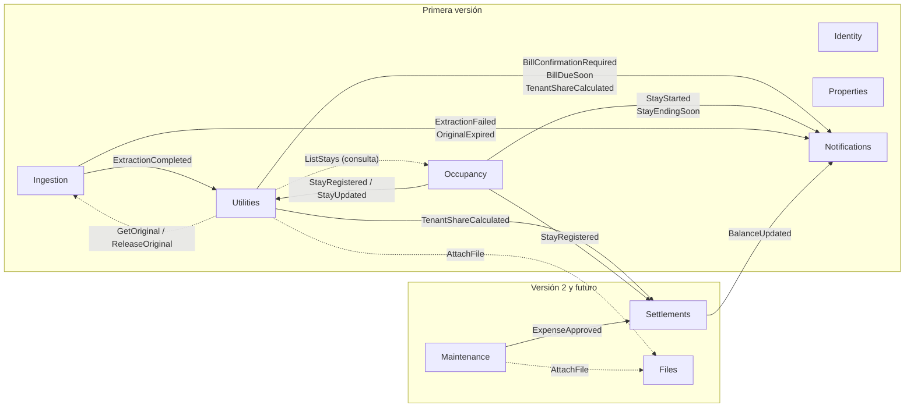
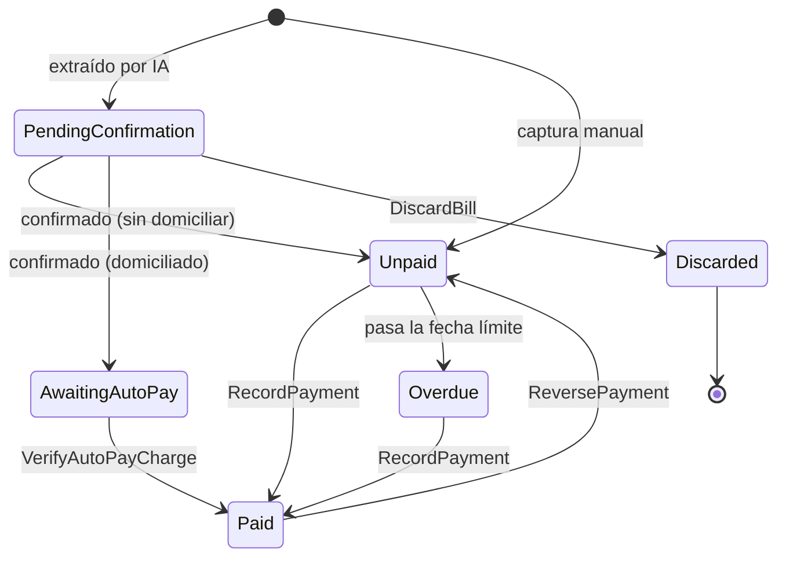
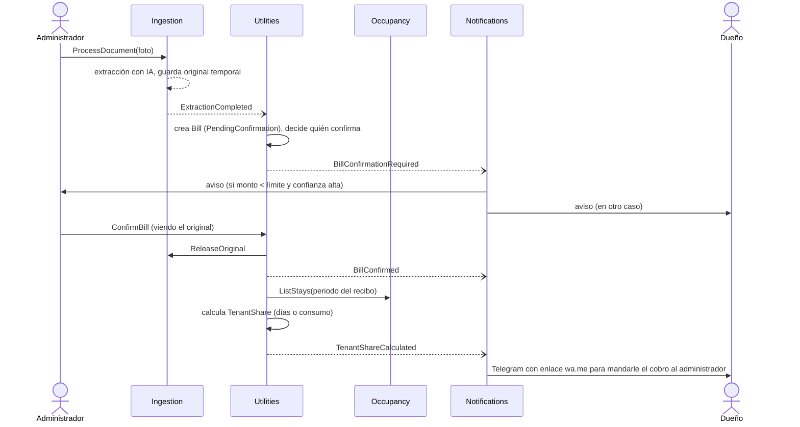

# Mapa de módulos — Administrador de Rentas

> **Versión:** 0.4.1 (borrador) · **Fecha:** 2026-11-23 · **Estado:** En revisión
>
> Este documento describe los módulos del monolito, qué datos tiene cada uno, qué expone y cómo se comunican. Debe cumplir el **Principio II** de la [constitución](../constitution.md). Los identificadores están en inglés ([ADR-0004](../adr/0004-idioma-del-codigo.md)); la traducción de cada concepto está en el [glosario](glosario.md).

---

## Convenciones

- **Comandos:** acciones que cambian estado, expuestas en la API pública del módulo. Verbo en imperativo (`RegisterBill`).
- **Consultas:** lecturas síncronas expuestas en la API pública. Empiezan con `Get…` o `List…`.
- **Eventos de integración:** hechos ya ocurridos que un módulo publica en el bus interno. Sustantivo + verbo en pasado (`BillConfirmed`).
  - Llevan **identificadores y los datos mínimos** que necesitan los consumidores, no entidades completas.
  - Viven en el proyecto de **contratos** del módulo que los publica (`AdminRentas.<Module>.Contracts`).
  - Los consumidores deben ser **idempotentes**: recibir un evento dos veces no duplica nada.
- **Datos:** cada módulo es dueño de un esquema en PostgreSQL con su nombre en minúsculas (`utilities`, `occupancy`, …).

---

## Vista general

- **Línea continua:** evento de integración (asíncrono, en el proceso).
- **Línea punteada:** consulta o comando a la API pública (síncrono).
- `Identity` y `Properties` no aparecen con flechas porque **todos** los módulos los consultan para validar acceso y obtener datos de la propiedad, como la zona horaria.

---

## Módulos de la primera versión

### 1. Identity (Identidad)

**Responsabilidad:** usuarios, autenticación, roles y qué propiedades puede ver cada usuario.

| | |
|---|---|
| **Datos** | `User` (nombre, correo, rol: `Owner` / `Manager`, chat de Telegram), `PropertyAssignment` (usuario ↔ propiedad) |
| **Comandos** | `InviteManager`, `AssignProperty`, `LinkTelegram` |
| **Consultas** | `GetCurrentUser`, `CanAccess(user, property)`, `ListPropertyUsers(property, role?)` |
| **Publica** | `ManagerAssigned` |
| **Consume** | — |

### 2. Properties (Propiedades)

**Responsabilidad:** datos generales de cada propiedad y su configuración.

| | |
|---|---|
| **Datos** | `Property` (nombre, dirección, `TimeZone`, moneda), `PropertySettings` (`ConfirmationThreshold`, valor inicial $1,500 MXN) |
| **Comandos** | `RegisterProperty`, `UpdateSettings` |
| **Consultas** | `GetProperty`, `GetSettings`, `ListProperties(user)` |
| **Publica** | `SettingsUpdated` |
| **Consume** | — |

### 3. Ingestion (Ingesta)

**Responsabilidad:** recibir documentos (foto, PDF o correo), extraer sus datos con IA y conservar el original **solo mientras se confirma** (constitución, Principios IV.2 y IV.3).

| | |
|---|---|
| **Datos** | `Extraction` (metadatos del documento: nombre, tipo, tamaño, `DocumentSource`, `ContentHash`, quién lo envió; proveedor y modelo de IA, campos extraídos, `Confidence`, advertencias), `TemporaryOriginal` (extracción, contenido, expiración) |
| **Comandos** | `ProcessDocument` (recibe el archivo, extrae y guarda el original temporal), `ReleaseOriginal(extraction)` (borra el original), `RetryExtraction` (solo mientras exista el original) |
| **Consultas** | `GetExtraction`, `GetOriginal(extraction)` (si sigue disponible), `HashExists(hash)` |
| **Publica** | `ExtractionCompleted`, `ExtractionFailed`, `DuplicateDocumentDetected`, `OriginalExpired` |
| **Consume** | — |
| **Puertos** | `IDocumentExtractor` (proveedor de IA), `IMailbox` (recibos reenviados por correo) |
| **Trabajos programados** | Diario: borra originales con más de 7 días → `OriginalExpired` |

- `ExtractionCompleted` lleva campos **genéricos de recibo** (proveedor, número de cuenta, periodo, consumo, monto, fecha límite, confianza). `Ingestion` **no conoce** el concepto de `Bill` de `Utilities`: solo extrae; la interpretación es de `Utilities`.
- Si la huella ya existe, no se llama a la IA y se publica `DuplicateDocumentDetected`. Esto también evita pagar dos veces por la misma extracción.
- El original se borra cuando `Utilities` llama a `ReleaseOriginal` (al confirmar o descartar el recibo) o cuando vence a los 7 días.
- `Ingestion` **no escucha eventos de `Utilities`**: es `Utilities` quien le avisa con un comando. Así la dependencia va en un solo sentido (`Utilities` → `Ingestion`) y no hay ciclo.

### 4. Utilities (Servicios)

**Responsabilidad:** servicios de la propiedad, sus recibos, pagos, medidores y el prorrateo hacia el inquilino.

| | |
|---|---|
| **Datos** | `Utility` (`Provider`, `AccountNumber`, `BillingFrequency`, `AutoPay`, tiene medidor), `Bill` (`BillingPeriod`, monto, consumo, `DueDate`, estado, extracción de origen), `Payment` (inmutable: monto, fecha, `PaymentReference`, reverso de), `MeterReading` (medidor, fecha, valor, quién la tomó), `TenantShare` (recibo, estancia, `ProrationMethod`, monto) |
| **Comandos** | `RegisterUtility`, `RegisterBill` (manual), `ConfirmBill`, `DiscardBill`, `RecordPayment`, `ReversePayment`, `VerifyAutoPayCharge`, `RecordMeterReading` |
| **Consultas** | `ListBills(property, status?, period?)`, `GetUtilitiesSummary(property)`, `GetConsumptionHistory(utility)` |
| **Publica** | `BillRegistered`, `BillConfirmationRequired`, `BillConfirmed`, `BillDiscarded`, `BillDueSoon`, `BillOverdue`, `BillPaid`, `PaymentReversed`, `TenantShareCalculated`, `HighConsumptionDetected` |
| **Consume** | `ExtractionCompleted` (crea el recibo *por confirmar*), `StayRegistered` / `StayUpdated` (recalcula prorrateos) |
| **Trabajos programados** | Diario: revisar vencimientos → `BillDueSoon` / `BillOverdue` |

**Estados del recibo:**

**Quién confirma** (constitución, Principio IV): si el monto es menor al `ConfirmationThreshold` y la IA no reporta baja confianza, puede confirmar el administrador; en cualquier otro caso, el dueño. `Utilities` obtiene el límite de `Properties`.

Al confirmar, la pantalla muestra los datos extraídos junto al original, que `Utilities` obtiene con `GetOriginal`. Al confirmar o descartar, `Utilities` llama a `ReleaseOriginal`.

Las **lecturas de medidor** viven en `Utilities` (el medidor pertenece al servicio), no en `Occupancy`. Al hacer check-in o check-out de una estancia con prorrateo por consumo, `Notifications` le recuerda al administrador tomar la lectura. Como no dependen de una estancia, también se pueden registrar **en cualquier momento**, y forman un historial de consumo por medidor útil para reportes futuros.

### 5. Occupancy (Ocupación)

**Responsabilidad:** inquilinos y estancias (vacacionales y mensuales).

| | |
|---|---|
| **Datos** | `Tenant` (alias, contacto), `Stay` (`StayType`: `Vacation` / `Monthly`, periodo `[inicio, fin)`, precio, `TenantPaysUtilities`, `ProrationMethod`) |
| **Comandos** | `RegisterStay`, `UpdateStay`, `CheckIn`, `CheckOut`, `CancelStay` |
| **Consultas** | `ListStays(property, period)`, `GetCurrentStay(property)`, `GetCalendar(property, range)` |
| **Publica** | `StayRegistered`, `StayUpdated`, `StayStarted`, `StayEnded`, `StayCancelled`, `StayEndingSoon` |
| **Consume** | — |
| **Trabajos programados** | Diario: estancias mensuales que terminan en 30 días → `StayEndingSoon` |

### 6. Notifications (Notificaciones)

**Responsabilidad:** avisar a las personas correctas por el canal correcto. No tiene lógica de negocio: reacciona a eventos.

| | |
|---|---|
| **Datos** | `NotificationPreference` (usuario, tipo de aviso, `Channel`), `MessageTemplate` (mensajes de Telegram, correo y WhatsApp), `DeliveryLog` (bitácora para no duplicar avisos) |
| **Comandos** | `UpdatePreferences` |
| **Consultas** | `BuildWhatsAppLink(template, data)` → enlace `wa.me` con texto armado |
| **Publica** | — |
| **Consume** | `BillConfirmationRequired`, `OriginalExpired`, `BillDueSoon`, `BillOverdue`, `TenantShareCalculated`, `HighConsumptionDetected`, `ExtractionFailed`, `StayStarted`, `StayEnded`, `StayEndingSoon`, `BalanceUpdated` (v2) |
| **Trabajos programados** | Semanal: `WeeklyDigest` por correo al dueño |
| **Puertos** | `ITelegramChannel`, `IEmailChannel` |

---

## Módulos de la versión 2 y futuros

### 7. Settlements (Liquidaciones)

**Responsabilidad:** estado de cuenta entre dueño y administrador.

| | |
|---|---|
| **Datos** | `LedgerEntry` (inmutable: tipo, monto, fecha, `PaymentReference`, reverso de). Tipos: `Rent`, servicios cobrados al inquilino, `ManagerFee`, `Expense`, `Transfer` (administrador → dueño), `Reimbursement` (dueño → administrador) |
| **Publica** | `LedgerEntryRecorded`, `BalanceUpdated` |
| **Consume** | `StayRegistered` (renta por cobrar), `TenantShareCalculated` (servicios por cobrar), `ExpenseApproved` |

### 8. Maintenance (Mantenimiento)

**Responsabilidad:** equipos, mantenimientos preventivos, tickets y proveedores.

| | |
|---|---|
| **Datos** | `Equipment` (minisplit, calentador…), `PreventivePlan`, `MaintenanceTicket` (reportado → cotizado → aprobado → resuelto), `Quote`, `Vendor` |
| **Publica** | `TicketReported`, `QuoteAwaitingApproval`, `ExpenseApproved`, `MaintenanceDue` |
| **Consume** | — |

### 9. Files (Archivos)

**Responsabilidad:** guardar archivos de forma permanente (recibos originales, comprobantes, fotos de medidor y de tickets) para consultarlos después.

| | |
|---|---|
| **Datos** | `StoredFile` (nombre, tipo, tamaño, `ContentHash`, ubicación, entidad a la que pertenece) |
| **Comandos** | `AttachFile`, `DeleteFile` |
| **Consultas** | `GetTemporaryUrl` (URL firmada) |
| **Puertos** | `IFileStorage` |

Cuando exista este módulo, `Ingestion` podrá entregarle el original antes de liberarlo, sin cambiar sus contratos.

---

## Flujos principales de la primera versión

### A. El administrador sube la foto de un recibo

### B. Vencimientos

1. El trabajo diario de `Utilities` busca recibos `Unpaid` con fecha límite cercana.
2. Publica `BillDueSoon` (5 días antes, configurable) o `BillOverdue`.
3. `Notifications` avisa al dueño por Telegram, sin duplicar avisos del mismo recibo y día.

### C. Check-in con prorrateo por consumo

1. El administrador hace `CheckIn` en `Occupancy` → `StayStarted` (con `ProrationMethod.ByConsumption`).
2. `Notifications` le pide al administrador la lectura del medidor de luz y agua.
3. El administrador registra las lecturas en `Utilities` con `RecordMeterReading`.
4. Al terminar la estancia se repite el ciclo, y `Utilities` usa ambas lecturas en el prorrateo.

---

## Aspectos transversales (fuera de los módulos)

| Tema | Dónde vive |
|---|---|
| **Núcleo compartido** (`SharedKernel`) | `Money`, `DateRange`, identificadores tipados, `Result` / `Error`. Sin lógica de negocio. |
| **Bus de eventos** | `Infrastructure`, en el proceso, con Wolverine ([ADR-0005](../adr/0005-bus-de-eventos-wolverine.md)). Los módulos publican con `IEventPublisher` en la misma transacción que su cambio (*outbox*); la entrega es asíncrona por colas locales durables. Las tablas de mensajes viven en el esquema compartido `wolverine`. |
| **Trabajos programados** | `Infrastructure`; cada módulo registra los suyos. |
| **Auditoría** | `Infrastructure`: quién, cuándo y qué, en cada comando. |
| **Autenticación** | La resuelve `Identity`; el host la aplica antes de llegar a cualquier módulo. |

---

## Reglas de dependencia (para pruebas de arquitectura)

1. Un módulo solo puede referenciar los **contratos** de otro (`AdminRentas.<Module>.Contracts`), nunca su implementación.
2. `Notifications` no es dependencia de nadie: solo consume eventos.
3. `Identity` y `Properties` no dependen de ningún otro módulo.
4. No hay dependencias circulares entre módulos, ni siquiera a través de contratos.
5. `SharedKernel` no depende de ningún módulo.
6. Ningún proyecto de módulo (implementación ni `.Contracts`) usa tipos del espacio de nombres `Wolverine`; solo `Infrastructure` y `Host` ([ADR-0005](../adr/0005-bus-de-eventos-wolverine.md)).
